  

  

  
  

## 💻 About Me

> `$ whoami` → **Dave**, cybersecurity student documenting hands-on labs in Linux, Windows, and networking
>
> `$ cat goals.txt` → IT Support → SOC Analyst → Cybersecurity Engineer
>
> `$ cat interests.txt` → Detection Engineering, Web Application Security

### 🌱 Currently
- 🔐 Learning Cybersecurity
- 🪟 Documenting Windows and Linux administration labs
- 🎯 Working toward my first IT support role

### 🚀 Goals
- [ ] Land a first IT support role
- [ ] Build my own SaaS product
- [ ] Become a SOC analyst
- [ ] Specialize in web application security

## 🛠️ Tools & Skills

  
  
  
  
   
  
  
  
   
  
  
  
  
  

## 📁 Projects

> `$ ls ~/IT-Home-Lab/Windows`

<table>
  <tr>
    <td width="33%" valign="top">
      <h3>🖥️ Remote Desktop (RDP)</h3>
      
Remote access from Kali Linux to a Windows 11 VM

      
      
        
      <a href="https://github.com/CyberXroot/IT-Home-Lab/tree/main/Windows/Remote-Desktop-RDP">View lab →</a>
    </td>
    <td width="33%" valign="top">
      <h3>👥 Users & Groups</h3>
      
User and permission management on Windows

      
      
        
      <a href="https://github.com/CyberXroot/IT-Home-Lab/tree/main/Windows/Local-Users-and-Groups">View lab →</a>
    </td>
    <td width="33%" valign="top">
      <h3>🛠️ Windows Services </h3>
      
Diagnosed and fixed a misconfigured Windows service

      
      
        
      <a href="https://github.com/CyberXroot/IT-Home-Lab/tree/main/Windows/windows-service-management-print-spooler">View lab →</a>
    </td>
  </tr>
</table>

## 📈 Skill Progress

  

## 🧑‍💻 A little more about me

  

  

  

